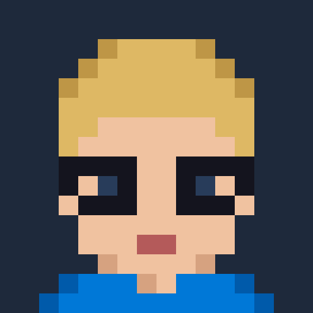

# Hi, I'm Robert 👋

## 🚀 About me
- ☁️ Fullstack Software Developer & DevOps Engineer at **WIIT**
- 🔧 Into automation, reliability and everything Linux
- 🌱 Always learning something new

## 🕰️ My journey
| Phase | What I did |
|---|---|
| 🎮 **Beginnings** | Started coding with **Java**, building **Spigot plugins** for Minecraft servers |
| 🐍 **Next step** | Moved on to **Python** for scripting and automation |
| 🌐 **Web** | Added **PHP**, **JavaScript** and **TypeScript** for fullstack web projects |
| 🖥️ **Infrastructure** | Got into **Proxmox** virtualization, **GitLab** CI/CD and Linux servers |
| ☁️ **Today** | Fullstack Software Developer & DevOps Engineer at **WIIT** |

## 🛠️ Tech stack

## 📊 GitHub stats

## 📌 Featured projects
<!-- Pin your best repos on your profile, or add them here -->
- _Coming soon_

## 📫 Contact

